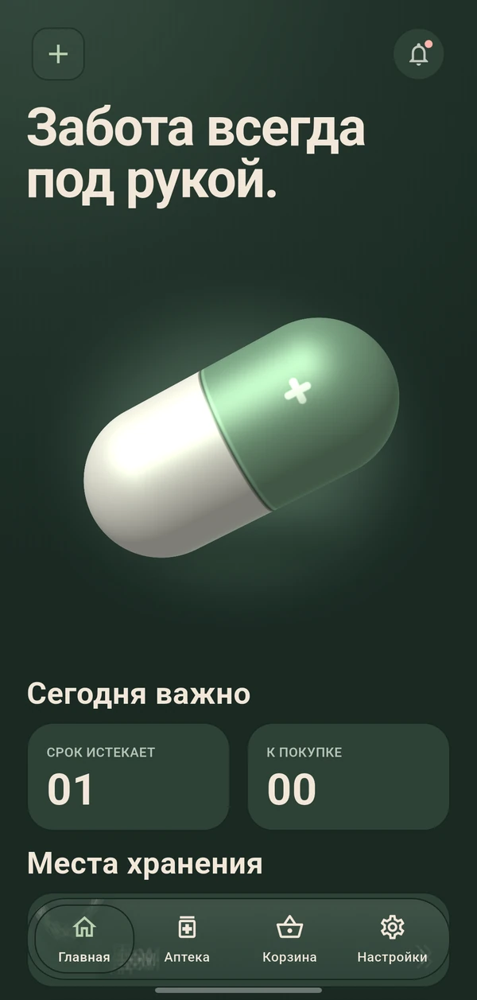
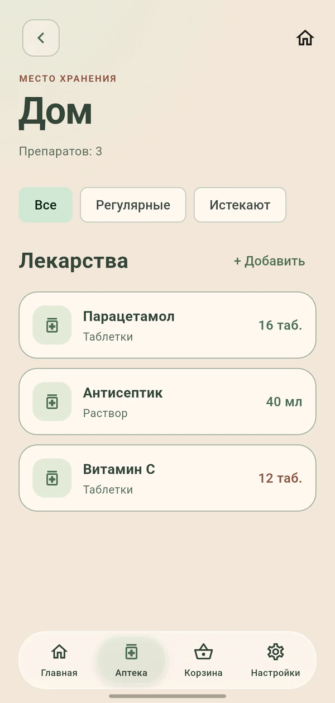
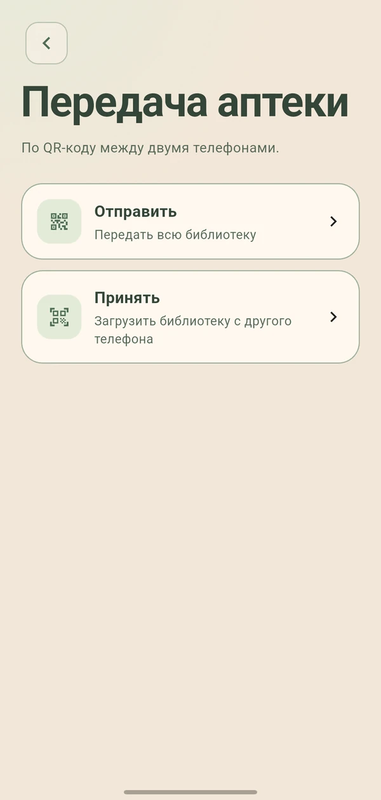

# Локальная аптека

Офлайн-приложение для Android. Храните список лекарств по местам, следите за остатками и сроками годности, настраивайте напоминания о приёме. Данные сжимаются и шифруются на устройстве.

[Скачать APK для Android ARM64](https://github.com/Wenwu-PA/local-pharmacy/releases/latest)

<p>
  
  
  
</p>

## Передача по QR

На принимающем телефоне откройте **Настройки → Передача аптеки → Принять**. На другом выберите **Отправить** и считайте этот QR. Затем отсканируйте коды отправителя на принимающем телефоне и подтвердите замену библиотеки. Передача работает без интернета.

## Сборка

Нужны Flutter 3.38+, JDK 17 и Android SDK 36. Скопируйте [пример настроек подписи](android/key.properties.example) в `android/key.properties` и укажите пути к своему PKCS#12 и файлу пароля.

```sh
flutter pub get
flutter test
flutter build apk --release --split-per-abi --target-platform android-arm64
```

APK для Android 7.0 и новее на ARM64 будет в `build/app/outputs/flutter-apk/app-arm64-v8a-release.apk`.
